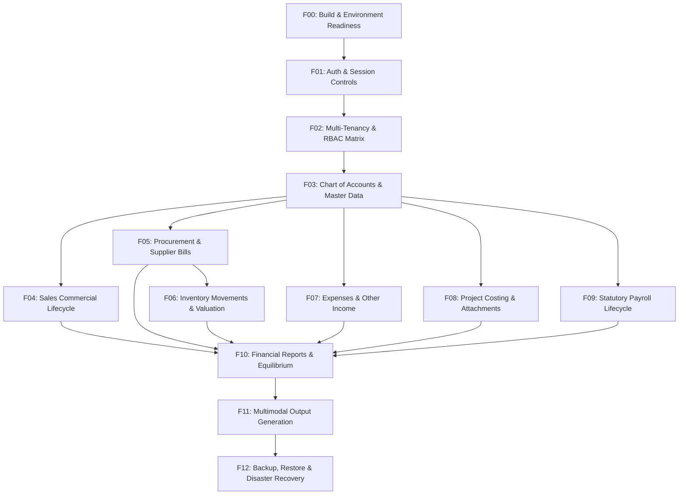

# SPARK ADMIN ERP — PRODUCTION BUILD ACCEPTANCE FLOW PLAN

**Document Version:** 1.0.0  
**Baseline Release Package:** `dist/spark-admin-release.zip` (SHA-256: `ed4a698503a905b8870110dbca2479104921f4043d5efd1d679e726b3a0a1085`, 295 files)  
**Baseline Git Commit:** `bfae7af0fab34bc16d3b832ae0537340f1c4360f` (with local security/staging documentation hardening)  
**Target Environments:** Staging / Pre-Production Pilot / Isolated Dedicated Test Business  
**Security Classification:** Strict Tenant Isolation / Zero Protected Database Mutations  

---

## 1. Test Mode Taxonomy & Production Safety Framework

To ensure that live production environments and genuine business data are never compromised, every acceptance flow in this plan is strictly categorized under one of two operational test modes:

### Mode A: Deployment Smoke Tests (PRODUCTION SAFE)
- **Scope:** Read-only system inspection, environment assertion, build identification, health diagnostics, public route verification, authentication verification, and read-only navigation.
- **Production Safety:** **SAFE FOR PRODUCTION**. These tests execute zero SQL write mutations (`INSERT`, `UPDATE`, `DELETE`, `DROP`, `ALTER`) and do not alter accounting ledgers, stock levels, sequence watermarks, or user sessions.
- **Allowed Targets:** Live Production, Staging, Pre-Production Pilot, Ephemeral Environments.

### Mode B: Transactional Acceptance Tests (NOT SAFE FOR LIVE PRODUCTION)
- **Scope:** Stateful business operations including customer/supplier creation, quotation conversion, tax invoice issuance, payments, stock movements, payroll generation, project costing, and ledger postings.
- **Production Safety:** **NOT SAFE FOR LIVE PRODUCTION**. These operations increment fiscal document numbering sequences, generate double-entry financial ledger journals, alter perpetual inventory valuations, and affect statutory tax reports.
- **Execution Rule:** Transactional acceptance tests must **ONLY** be executed against:
  1. An isolated staging database (`spark_admin_staging`), OR
  2. An explicitly designated disposable test tenant (`businessId: 999` / "Acceptance Sandbox Ltd") specifically created for acceptance verification in a pre-production pilot.
- **Cleanup Invariant:** Never delete genuine business records or reverse live production journals. On disposable staging targets, reset via documented clean database restoration drills only.

---

## 2. Master Acceptance Flow Catalogue (F00 – F12)



---

### Flow F00: Build Identity, Application Health, Configuration & Database Connectivity

- **Flow ID:** `FLOW-F00`
- **Flow Name:** Build Identity, Application Health, Configuration & Database Connectivity
- **Purpose:** Assert that the deployed application matches the verified release manifest, runtime environment is healthy, configuration presence and secret masking are verified, database connectivity is established without secret leakage, and forward schema migrations are 100% applied without executing state-changing transactions.
- **Risk Level:** Low (Strictly Read-Only)
- **Deployment Mode:** **Mode A (PRODUCTION SAFE)**
- **Required Role / Permission:** System Administrator (SSH/Terminal) & Unauthenticated HTTP Observer
- **Preconditions:** Server running Node.js v24 LTS; MariaDB 11.4+ / MySQL 8.0+ running; `.env` populated with appropriate environment profile.
- **Synthetic Test Data:** None (Read-only inspection of host system state).

#### Safe Host-Specific Preflight Procedure (Operator Execution Guide)

Before executing any environment-dependent command on the target host:
1. **Target Environment Classification:**
   - Establish whether the target host is `LOCAL`, `STAGING`, or `PRODUCTION`.
   - Record target hostname, IP, and assigned purpose in the execution log.
2. **Application Directory & Build Identity Verification:**
   - Verify active directory: `pwd` (Expected Linux: `/opt/spark-admin/app` or staging equivalent).
   - Check release archive checksum before extraction or compare with manifest:
     ```bash
     sha256sum dist/spark-admin-release.zip
     # Expected SHA-256: ed4a698503a905b8870110dbca2479104921f4043d5efd1d679e726b3a0a1085
     ```
   - Check release manifest:
     ```bash
     cat dist/release-manifest.json | grep -E '"(commit|version|archiveSha256|fileCount)"'
     # Expected: commit: bfae7af0fab34bc16d3b832ae0537340f1c4360f, fileCount: 295
     ```
3. **Configuration Presence & Secret Masking Audit:**
   - Verify `.env` file exists and has restrictive permissions:
     ```bash
     ls -la .env
     # Expected Linux: -rw------- (chmod 600), owner: sparkadmin:sparkadmin
     ```
   - Verify required non-secret keys are defined without echoing secret values:
     ```bash
     grep -E '^(NODE_ENV|PORT|DATABASE_HOST|DATABASE_PORT|DATABASE_NAME|ATTACHMENT_STORAGE_DIR)=' .env
     ```
   - **CRITICAL SAFETY GUARD:** Inspect `DATABASE_NAME`. If testing against staging or disposable environments, verify `DATABASE_NAME` is strictly set to an isolated test target (e.g. `spark_admin_staging`) and NEVER a protected database (`admin`, `spark_admin`, `spark_admin_prod`, `spark_admin_test`, `spark_admin_prod_test`). If testing production smoke, verify the command is run during an authorised maintenance window.
   - Verify persistent attachment storage directory setting:
     Canonical production path: `ATTACHMENT_STORAGE_DIR=/var/lib/spark-admin/attachments`.
4. **Active Database Read-Only Connection & Safety Confirmation:**
   - Confirm active database identity directly via SQL read-only session:
     ```bash
     mysql -h localhost -u "$DATABASE_USER" -p -e "SELECT DATABASE() AS active_db, USER() AS connected_user, @@version AS engine_version;"
     ```
   - Confirm that the active database matches the expected target and does not inadvertently target a protected or misconfigured schema.
5. **Schema Migration Status Inspection (READ-ONLY):**
   - Inspect migration alignment non-destructively:
     ```bash
     npx prisma migrate status
     ```
   - **CRITICAL OPERATIONAL RULE:** `prisma migrate status` is for read-only inspection. It must **NEVER** be treated as authorization or permission to run `prisma migrate deploy` or `prisma migrate reset`.
   - Expected Output: `Database schema is up to date` (all 23 migrations applied from `20260925090401_init` to `20261017183000_add_project_costing_and_attachments`).
6. **System Health Diagnostic Audit:**
   - Execute the 20-point diagnostic health check:
     ```bash
     node scripts/doctor.js
     ```
   - Expected Output: `Diagnostic Summary: 20/20 PASS, 0 WARN, 0 FAIL`.
   - Assert zero database passwords or private keys printed to stdout/stderr.
7. **HTTP Public Endpoint Assertion:**
   - Send an unauthenticated HTTP request to verify port binding and routing:
     ```bash
     curl -i http://127.0.0.1:3000/login
     ```
   - Expected Output: HTTP 200 OK, session cookie `spark.sid` with `HttpOnly`, security headers `X-Content-Type-Options: nosniff`.

- **Expected Database & State Changes:**
  - Strictly **ZERO** mutations. Zero inserts, updates, deletes, or DDL operations.
- **Expected Accounting Entries:** None.
- **Negative Cases & Security Checks:**
  - If `.env` permissions are wider than 600, fail the check.
  - If `DATABASE_NAME` in a staging run targets a protected database name, abort immediately.
  - If `doctor.js` leaks secret values in its report, flag as High severity security defect.
- **Evidence to Capture:**
  - Checksum hash output.
  - Manifest snippet.
  - Masked `.env` key presence confirmation.
  - `SELECT DATABASE()` query result.
  - `npx prisma migrate status` output.
  - `node scripts/doctor.js` summary.
  - HTTP response header capture.
- **Initial Status:** `NOT RUN` (Unless actively executed on the deployment host with attached evidence).
- **Safe Retest & Rollback:** Safe to rerun unconditionally at any time.

---

### Flow F01: Login, Logout, Session Expiry & Password/Security Controls

- **Flow ID:** `FLOW-F01`
- **Flow Name:** Authentication, Session Lifecycle, Password Masking & Security Hardening
- **Purpose:** Validate user authentication, CSRF protection on state-changing requests, rate-limiting on brute-force login attempts, session destruction on logout, and masked interactive credential rotation.
- **Risk Level:** Medium (Authentication state mutations)
- **Deployment Mode:** **Mode A (PRODUCTION SAFE for login/logout); Mode B for password rotation**
- **Required Role / Permission:** Any valid user account (`OWNER`, `ADMIN`, `MANAGER`, `MEMBER`, `VIEWER`)
- **Preconditions:** System provisioned with active user `admin@email.com`.
- **Synthetic Test Data:**
  - Valid user: `admin@email.com` / `ValidP@ssw0rd2026!`
  - Invalid user: `ghost@email.com` / `WrongPass123!`
  - Test rotation password: `RotatedSecureP@ss2026!`
- **Numbered UI & CLI Steps:**
  1. Navigate to `http://127.0.0.1:3000/login`.
  2. Attempt login with empty credentials: Click "Sign In".
  3. Attempt login with invalid password: Enter `admin@email.com` and `WrongPass123!`.
  4. Attempt 11 rapid invalid logins to verify rate limiting (`express-rate-limit`).
  5. Log in with valid credentials. Verify redirect to `/` or `/dashboard`.
  6. Inspect cookie in browser developer tools: Verify `spark.sid` is `HttpOnly`.
  7. Click user avatar in header &rarr; Click "Sign Out" (`POST /logout`).
  8. Press browser "Back" button: Verify page redirects to `/login`.
  9. CLI Password Rotation Verification (on disposable account):
     `node scripts/rotate-password.js --email="admin@email.com"` (without `--password` CLI argument).
     Verify masked terminal prompt (`*` characters).
- **Exact Expected UI/API Result:**
  - Step 2: Form validation error "Email and password are required".
  - Step 3: Flash error "Invalid email or password", HTTP 401.
  - Step 4: After threshold, HTTP 429 "Too many login attempts, please try again later."
  - Step 5: HTTP 302 redirect to `/dashboard`, session established.
  - Step 7: Session destroyed in database `sessions` table; cookie cleared; redirect to `/login`.
  - Step 8: Unauthenticated access to `/dashboard` blocked with HTTP 302 redirect to `/login`.
  - Step 9: Script prompts with masked input; confirms `SELECT DATABASE()`; updates password; invalidates user sessions.
- **Expected Database & State Changes:**
  - `sessions` table: Session record inserted on login, deleted on logout.
  - `user_activity_logs`: `LOGIN`, `LOGIN_FAILED`, `LOGOUT` events recorded.
- **Expected Accounting Entries:** None.
- **Negative Cases & Security Checks:**
  - Test submitting login without CSRF token (`_csrf`): Returns HTTP 403 Forbidden.
  - Passing `--password` or `-p` to `rotate-password.js`: Strictly rejected with exit code 1.
- **Evidence to Capture:**
  - Browser screenshot of login error and successful dashboard.
  - CLI output showing masked prompt and targeted session invalidation.
- **Initial Status:** `NOT RUN`
- **Safe Retest & Rollback:** Re-login with original credentials.

---

### Flow F02: Multi-Business Isolation, RBAC & Access Denial

- **Flow ID:** `FLOW-F02`
- **Flow Name:** Multi-Business Tenant Isolation & Role-Based Access Control (RBAC) Matrix
- **Purpose:** Prove strict tenant boundary enforcement between separate businesses, verify that users cannot view or manipulate data belonging to another business, and verify that role-based permissions deny unauthorized actions.
- **Risk Level:** High (Multi-tenant security boundary)
- **Deployment Mode:** **Mode A / Mode B**
- **Required Role / Permission:** Multi-tenant users (`OWNER`, `MANAGER`, `VIEWER`) across Business 1 & Business 2
- **Preconditions:** At least two distinct businesses exist in the database (e.g., Business 1: `Acme Corp`, Business 2: `Beta Logistics`).
- **Synthetic Test Data:**
  - Business 1: ID 1 (`Acme Corp`)
  - Business 2: ID 2 (`Beta Logistics`)
  - User A: Member of Business 1 only (`MEMBER` role)
  - User B: Member of Business 2 only (`VIEWER` role)
- **Numbered UI & CLI Steps:**
  1. Log in as User A (Business 1). Navigate to `/documents`. Note Document IDs listed.
  2. Attempt direct GET access to an invoice belonging to Business 2: `GET /documents/<Business2_Invoice_ID>`.
  3. Attempt direct API access to Business 2 customer: `GET /api/clients/<Business2_Client_ID>`.
  4. Attempt direct API mutation on Business 2 quotation: `POST /api/invoices/<Business2_Quotation_ID>/status`.
  5. Navigate to `/reports/trial-balance` as User A (`MEMBER` role without `REPORTS:VIEW`).
  6. Switch active business context via `/switch-business`: Select Business 2 as an authorized multi-tenant user.
- **Exact Expected UI/API Result:**
  - Step 2: HTTP 404 Not Found (Application hides document existence across business boundaries).
  - Step 3: HTTP 404 Not Found.
  - Step 4: HTTP 404 Not Found / 403 Forbidden.
  - Step 5: HTTP 403 Forbidden ("You do not have permission to view reports").
  - Step 6: Session context updates `req.session.activeBusinessId = 2`; header branding switches dynamically.
- **Expected Database & State Changes:**
  - All queries include `WHERE businessId = ?`. Zero cross-tenant leakage.
  - `user_activity_logs`: `PERMISSION_DENIED` event logged on unauthorized role attempts.
- **Expected Accounting Entries:** None.
- **Negative Cases & Security Checks:**
  - SQL injection attack on business switch: Passing `businessId = "1 OR 1=1"` returns HTTP 400 Validation Error.
- **Evidence to Capture:**
  - Screenshots of HTTP 404 / 403 denial pages.
  - JSON response verifying empty list when querying cross-tenant records.
- **Initial Status:** `NOT RUN`
- **Safe Retest & Rollback:** Safe to rerun unconditionally.

---

### Flow F03: Chart of Accounts & Master Data Setup

- **Flow ID:** `FLOW-F03`
- **Flow Name:** Chart of Accounts, Unit Master, Item Master & Customer/Supplier Onboarding
- **Purpose:** Configure baseline master entities required for operational ERP transactions, verifying GST validation, case preservation, snapshot immutability, and predefined system account keys.
- **Risk Level:** Medium (Master data insertions)
- **Deployment Mode:** **Mode B (NOT SAFE FOR PRODUCTION - Test Business Only)**
- **Required Role / Permission:** `ADMIN` or `OWNER` with `CLIENTS:CREATE`, `ITEMS:CREATE`, `ACCOUNTS:VIEW`
- **Preconditions:** Active business context established; financial year initialized (e.g. FY 2026-27).
- **Synthetic Test Data:**
  - Customer: `Apex Engineering Pvt Ltd`, GSTIN: `27AAPCA1234F1Z5`, State Code: `27` (Maharashtra), Address: `Plot 42, MIDC, Andheri East, Mumbai 400093`.
  - Supplier: `Bharat Metal Castings LLP`, GSTIN: `24AABCB5678G1Z2`, State Code: `24` (Gujarat), Address: `GIDC Phase 2, Vatva, Ahmedabad 382445`.
  - Unit: Symbol `MTR`, Formal Name `Meter`, Decimal Places: `2`.
  - Item: Code `ITM-SS-PIPE`, Name `Stainless Steel Seamless Pipe 50mm`, Rate: `₹1,250.00`, Unit: `MTR`, HSN: `7304`.
- **Numbered UI & CLI Steps:**
  1. Navigate to `/reports/general-ledger`. Inspect Chart of Accounts: Verify core system keys (`1111`, `1112`, `1121`, `1141`, `1151-1153`, `2121`, `2131-2133`, `3110`, `4110`, `5110`, `5220`).
  2. Navigate to `/units`. Click "Add Unit". Enter Symbol `MTR`, Name `Meter`. Submit form.
  3. Navigate to `/documents/new`. Under "Items", open Item modal or type new item `Stainless Steel Seamless Pipe 50mm`. Select Unit `MTR`, Rate `1250`.
  4. In customer autocomplete, click "Add Client". Enter Name, valid 15-char GSTIN, billing address. Save client.
  5. Navigate to `/purchases/bills/new`. Click "Add Supplier". Enter Name `Bharat Metal Castings LLP`, GSTIN, State Code `24`. Save supplier.
- **Exact Expected UI/API Result:**
  - Unit listed in active units table with status `ACTIVE`.
  - Customer saved with ID and auto-selected in document editor; State Code auto-populated.
  - Supplier saved and selectable in `/purchases/bills/new`.
  - Chart of accounts returns system accounts with correct account classifications (`ASSET`, `LIABILITY`, `EQUITY`, `INCOME`, `EXPENSE`).
- **Expected Database & State Changes:**
  - `units`: Row inserted with `symbol = 'MTR'`, `businessId = ?`.
  - `items`: Row inserted with `name = 'Stainless Steel Seamless Pipe 50mm'`, `rate = 1250.00`.
  - `clients`: Row inserted with `gstin = '27AAPCA1234F1Z5'`, `stateCode = '27'`.
  - `suppliers`: Row inserted with `gstin = '24AABCB5678G1Z2'`, `stateCode = '24'`.
- **Expected Accounting Entries:** None (Master data creation does not touch ledger).
- **Negative Cases & Security Checks:**
  - Invalid GSTIN (e.g. `27INVALID123`): Form rejects with validation error "Invalid GSTIN format".
  - Duplicate unit symbol: Rejects with HTTP 400 "Unit symbol already exists".
- **Evidence to Capture:**
  - Screenshot of saved client card, unit master table, and supplier modal.
- **Initial Status:** `NOT RUN`
- **Safe Retest & Rollback:** Deactivate or delete test client/unit in test business.

---

### Flow F04: Sales Commercial Lifecycle (Quotation &rarr; Invoice &rarr; Payments &rarr; Credit Note)

- **Flow ID:** `FLOW-F04`
- **Flow Name:** End-to-End Sales Lifecycle, Tax Invoicing, Payments & Credit Adjustment
- **Purpose:** Execute a complete commercial sales lifecycle from quotation to balanced tax invoice, multi-stage receipts, conflict-guarded duplicate conversion prevention, and credit note issuance.
- **Risk Level:** Critical (Invoicing, GST calculation, Double-entry GL journals)
- **Deployment Mode:** **Mode B (NOT SAFE FOR PRODUCTION - Test Business Only)**
- **Required Role / Permission:** `MANAGER` or `OWNER` with `DOCUMENTS:CREATE`, `DOCUMENTS:EDIT`, `DOCUMENTS:VOID`, `CREDIT_NOTES:CREATE`
- **Preconditions:** Active client `Apex Engineering Pvt Ltd` (State 27); open financial year (FY 2026-27). Company State Code is `27` (Intra-state CGST + SGST applies).
- **Synthetic Test Data:**
  - Line Item: 10 MTR `Stainless Steel Seamless Pipe 50mm` @ `₹1,250.00` = `₹12,500.00` Taxable.
  - GST: Intra-State (CGST 9% = `₹1,125.00`, SGST 9% = `₹1,125.00`). Total Tax: `₹2,250.00`.
  - Grand Total: `₹14,750.00`.
  - Partial Payment 1: `₹7,000.00` via Bank Transfer.
  - Final Payment 2: `₹7,750.00` via UPI.
  - Credit Note: Return of 1 MTR (`₹1,250.00` taxable + `₹225.00` GST = `₹1,475.00`).
- **Numbered UI & CLI Steps:**
  1. Navigate to `/documents/new?type=QUOTATION`. Select client `Apex Engineering Pvt Ltd`.
  2. Add item: Qty `10`, Rate `1250`, GST Rate `18%`. Click "Save Quotation". Note generated Quotation number (`QUOT/2026/10/1`).
  3. On quotation detail view (`/documents/:id`), click "Convert to Invoice". Confirm modal.
  4. Verify redirect to newly generated Tax Invoice (`INV/2026/10/1`).
  5. Re-attempt conversion on original quotation via direct POST API:
     `POST /api/invoices/<quotation_id>/convert`.
     Verify HTTP 409 Conflict guard blocks duplicate invoice creation.
  6. On invoice detail view, click "Record Payment".
     - Amount: `₹7,000.00`, Method: `BANK_TRANSFER`, Reference: `NEFT-TEST-001`. Submit.
  7. Verify invoice payment status shows `PARTIAL`, remaining balance `₹7,750.00`.
  8. Click "Record Payment" again. Attempt overpayment: enter `₹10,000.00`. Confirm rejection.
  9. Record valid final payment: Amount `₹7,750.00`, Method: `UPI`. Status transitions to `PAID`.
  10. Navigate to `/credit-debit-notes`. Click "Issue Credit Note". Select Invoice `INV/2026/10/1`.
      - Reason: "Goods returned by customer", Item: 1 MTR @ `₹1,250.00` + 18% GST = `₹1,475.00`. Submit.
- **Exact Expected UI/API Result:**
  - Quotation transitions to `CONVERTED` and displays reciprocal link to generated invoice.
  - Invoice displays `invoiceNumber = 'INV/2026/10/1'`, status `PAID`, balance `₹0.00`.
  - Duplicate conversion returns HTTP 409 Conflict with clear error message.
  - Credit Note `CRN/2026/10/1` generated and linked to source invoice.
- **Expected Database & State Changes:**
  - `invoices`: Row updated with `status = 'PAID'`, `convertedToInvoiceId` linked.
  - `payments`: Two payment records created with `amount = 7000.00` and `7750.00`.
  - `credit_debit_notes`: Row created with `noteType = 'CREDIT_NOTE'`, `amount = 1475.00`.
- **Expected Accounting Entries (Double-Entry GL Journals):**
  - **Invoice Posting (`INVOICE:INV/2026/10/1`):**
    - Debit: `1121 ACCOUNTS_RECEIVABLE` &rarr; `₹14,750.00`
    - Credit: `4110 SALES_REVENUE` &rarr; `₹12,500.00`
    - Credit: `2131 OUTPUT_CGST` &rarr; `₹1,125.00`
    - Credit: `2132 OUTPUT_SGST` &rarr; `₹1,125.00`
  - **Partial Payment 1 (`PAYMENT:1`):**
    - Debit: `1112 BANK_ACCOUNT` &rarr; `₹7,000.00`
    - Credit: `1121 ACCOUNTS_RECEIVABLE` &rarr; `₹7,000.00`
  - **Final Payment 2 (`PAYMENT:2`):**
    - Debit: `1112 BANK_ACCOUNT` &rarr; `₹7,750.00`
    - Credit: `1121 ACCOUNTS_RECEIVABLE` &rarr; `₹7,750.00`
  - **Credit Note (`CREDIT_NOTE:1`):**
    - Debit: `4120 SALES_RETURNS` &rarr; `₹1,250.00`
    - Debit: `2131 OUTPUT_CGST` &rarr; `₹112.50`
    - Debit: `2132 OUTPUT_SGST` &rarr; `₹112.50`
    - Credit: `1121 ACCOUNTS_RECEIVABLE` &rarr; `₹1,475.00`
- **Negative Cases & Security Checks:**
  - Attempting to edit invoice after status is `PAID` or `VOID` returns HTTP 400.
  - Customer subledger balance strictly reconciles with GL Account `1121`.
- **Evidence to Capture:**
  - Desktop and mobile screenshots of invoice view with payment history.
  - JSON dump of journal entry from `/api/journals/:id`.
- **Initial Status:** `NOT RUN`
- **Safe Retest & Rollback:** Void test payment or test credit note in sandbox business.

---

### Flow F05: Procurement Lifecycle (Purchase Order &rarr; Supplier Bill &rarr; Payment)

- **Flow ID:** `FLOW-F05`
- **Flow Name:** Procurement Lifecycle, AP Invariance & Supplier Bill Settlement
- **Purpose:** Execute procurement workflow, prove that Standalone Purchase Orders strictly do NOT alter the accounting ledger, verify balanced liability creation on Supplier Bill, and settle through Accounts Payable.
- **Risk Level:** High (Accounts Payable, Purchasing GL posting)
- **Deployment Mode:** **Mode B (NOT SAFE FOR PRODUCTION - Test Business Only)**
- **Required Role / Permission:** `MANAGER` or `OWNER` with `DOCUMENTS:CREATE`, `DOCUMENTS:VIEW`
- **Preconditions:** Active supplier `Bharat Metal Castings LLP` (State 24); Company State 27 (Inter-state IGST applies).
- **Synthetic Test Data:**
  - Item: 20 MTR `Stainless Steel Seamless Pipe 50mm` @ `₹1,000.00` = `₹20,000.00` Taxable.
  - Tax: Inter-state IGST 18% = `₹3,600.00`. Total: `₹23,600.00`.
  - Supplier Bill Number: `BILL-BMC-2026-099`.
- **Numbered UI & CLI Steps:**
  1. Navigate to `/purchases/orders/new`. Select supplier `Bharat Metal Castings LLP`.
  2. Add item: Qty `20`, Rate `1000`. Verify live recalculation in editor.
  3. Click "Save Purchase Order". Note PO Number (`PO/2026/10/1`).
  4. Navigate to `/purchases/orders/:id`. Verify standalone PO detail view renders items and total `₹23,600.00`.
  5. **CRITICAL INVARIANCE CHECK:** Navigate to `/reports/journals`.
     Search for `PO/2026/10/1`. Verify ZERO journal entries were posted.
  6. Navigate to `/purchases/bills/new`. Select supplier `Bharat Metal Castings LLP`.
     Enter Bill Number `BILL-BMC-2026-099`, Bill Date, Item: Qty `20`, Rate `1000`, IGST `18%`.
  7. Check "Inventory Purchase" checkbox (`isInventory: true`). Submit bill.
  8. Navigate to `/reports/journals`. Locate posted journal for `SUPPLIER_BILL:<id>`.
  9. Execute payment via API: `POST /api/supplier-payments` with `supplierBillId`, amount `23600.00`, method `BANK_TRANSFER`.
- **Exact Expected UI/API Result:**
  - PO created with status `ISSUED`. Detail view clickable and formatted.
  - Supplier Bill created with status `POSTED`, total `₹23,600.00`.
  - Supplier Payment recorded, settling bill status to `PAID`.
- **Expected Database & State Changes:**
  - `purchase_orders`: Row created, status `ISSUED`.
  - `supplier_bills`: Row created, status `POSTED`.
  - `supplier_payments`: Row created, status `POSTED`.
- **Expected Accounting Entries (Double-Entry GL Journals):**
  - **Purchase Order:** **NO JOURNAL POSTED (0 lines, zero ledger effect)**.
  - **Supplier Bill (`SUPPLIER_BILL:<id>`):**
    - Debit: `1141 INVENTORY_ASSET` (or `5110 COGS` if non-inventory) &rarr; `₹20,000.00`
    - Debit: `1153 INPUT_IGST` &rarr; `₹3,600.00`
    - Credit: `2121 ACCOUNTS_PAYABLE` &rarr; `₹23,600.00`
  - **Supplier Payment (`SUPPLIER_PAYMENT:<id>`):**
    - Debit: `2121 ACCOUNTS_PAYABLE` &rarr; `₹23,600.00`
    - Credit: `1112 BANK_ACCOUNT` &rarr; `₹23,600.00`
- **Negative Cases & Security Checks:**
  - Duplicate bill number for same supplier: Rejects with HTTP 409 Conflict.
  - Overpayment exceeding outstanding balance: Rejects with HTTP 400.
- **Evidence to Capture:**
  - Screenshot of PO detail view.
  - Journal Register screenshot proving no PO entry, followed by balanced Bill and Payment entries.
- **Initial Status:** `NOT RUN`
- **Safe Retest & Rollback:** Void test supplier bill or test payment in sandbox business.

---

### Flow F06: Inventory Receipt, Issue, Stock Valuation & COGS Realization

- **Flow ID:** `FLOW-F06`
- **Flow Name:** Perpetual Inventory Movements, Weighted-Average Costing & COGS Posting
- **Purpose:** Validate physical stock inward receipts, outward consumption issues, weighted-average cost recalculation, and automatic `Dr COGS / Cr Inventory Asset` ledger posting.
- **Risk Level:** High (Inventory valuation & asset balances)
- **Deployment Mode:** **Mode B (NOT SAFE FOR PRODUCTION - Test Business Only)**
- **Required Role / Permission:** `MANAGER` or `OWNER` with `ITEMS:CREATE`, `ITEMS:VIEW`
- **Preconditions:** Item `ITM-SS-PIPE` exists with zero starting stock.
- **Synthetic Test Data:**
  - Receipt 1: 100 units @ `₹100.00` = `₹10,000.00`.
  - Receipt 2: 100 units @ `₹200.00` = `₹20,000.00`.
  - Expected Weighted Average Cost: `(10,000 + 20,000) / 200 = ₹150.00 / unit`.
  - Issue 1: 50 units for production/project. Cost = `50 * 150 = ₹7,500.00`.
  - Issue 2 (Negative Test): Attempt issue of 250 units (exceeds remaining 150).
- **Numbered UI & CLI Steps:**
  1. Record Stock Receipt 1 via `POST /api/inventory/movements`:
     `itemId`, `movementType: 'RECEIPT'`, `quantity: 100`, `unitCost: 100.00`.
  2. Record Stock Receipt 2 via `POST /api/inventory/movements`:
     `itemId`, `movementType: 'RECEIPT'`, `quantity: 100`, `unitCost: 200.00`.
  3. Query stock summary: `GET /api/inventory/summary/:itemId`.
     Verify `currentStock = 200`, `weightedAverageCost = 150.00`, `valuation = 30000.00`.
  4. Record Stock Issue 1 via `POST /api/inventory/movements`:
     `itemId`, `movementType: 'ISSUE'`, `quantity: 50`, `postToLedger: true`, `notes: 'Issued to Project'`.
  5. Query stock summary again: Verify `currentStock = 150`, `valuation = 22500.00`.
  6. Attempt Stock Issue 2: `quantity: 250`. Confirm rejection.
  7. Navigate to `/reports/general-ledger`. Query Account `1141 INVENTORY_ASSET`.
- **Exact Expected UI/API Result:**
  - Step 3 returns JSON: `{ currentStock: 200, weightedAverageCost: 150, valuation: 30000 }`.
  - Step 4 returns HTTP 201 with generated `movementNumber = 'STK/2026/10/1'`.
  - Step 6 returns HTTP 400 "Insufficient stock available. Requested: 250, Available: 150".
- **Expected Database & State Changes:**
  - `stock_movements`: Rows created for receipts and issue.
  - `items`: Cache updated if applicable.
- **Expected Accounting Entries (Double-Entry GL Journals):**
  - **Stock Issue (`STOCK_MOVEMENT:<id>`):**
    - Debit: `5110 COGS` (or `DIRECT_MATERIALS`) &rarr; `₹7,500.00`
    - Credit: `1141 INVENTORY_ASSET` &rarr; `₹7,500.00`
- **Negative Cases & Security Checks:**
  - Submitting negative or zero quantity returns HTTP 400 Validation Error.
- **Evidence to Capture:**
  - API responses for summary before and after issue.
  - General Ledger line item showing `₹7,500.00` credit to Inventory Asset.
- **Initial Status:** `NOT RUN`
- **Safe Retest & Rollback:** Perform adjustment receipt in sandbox business.

---

### Flow F07: Direct Ledger Posting: Operating Expenses & Other Income

- **Flow ID:** `FLOW-F07`
- **Flow Name:** Operating Expenses, Miscellaneous Income & Direct Ledger Postings
- **Purpose:** Validate direct cash/bank operational expenditures and miscellaneous income postings, verifying CSRF token handling, user context extraction, and P&L impact.
- **Risk Level:** Medium (Financial expense/income ledger mutations)
- **Deployment Mode:** **Mode B (NOT SAFE FOR PRODUCTION - Test Business Only)**
- **Required Role / Permission:** `MANAGER` or `OWNER` with `ACCOUNTS:CREATE`, `ACCOUNTS:VIEW`
- **Preconditions:** Open financial year; Chart of accounts contains `5220 OPERATING_EXPENSES` and `4190 OTHER_INCOME`.
- **Synthetic Test Data:**
  - Expense: Office Internet & Utility Bill, Amount: `₹7,500.00`, Method: `BANK_TRANSFER`, Ref: `EXP-UTILITY-001`.
  - Income: Scrap Metal Disposal Sale, Amount: `₹14,500.00`, Method: `BANK_TRANSFER`, Ref: `INC-SCRAP-001`.
- **Numbered UI & CLI Steps:**
  1. Navigate to `/financials/expenses`.
  2. Fill Expense form: Category `UTILITIES`, Amount `7500`, Payment Mode `BANK_TRANSFER`, Reference `EXP-UTILITY-001`, Date: Today.
  3. Submit form. Verify Expense #EXP/2026/10/1 appears in recent expense list.
  4. Navigate to `/financials/other-income`.
  5. Fill Other Income form: Category `SCRAP_SALE`, Amount `14500`, Received Mode `BANK_TRANSFER`, Reference `INC-SCRAP-001`.
  6. Submit form. Verify Income #INC/2026/10/1 appears in recent income list.
  7. Navigate to `/reports/profit-and-loss`. Inspect "Operating Expenses" and "Other Income".
- **Exact Expected UI/API Result:**
  - Expense and Other Income records persist with auto-assigned monthly sequential numbers.
  - Flash message "Expense recorded successfully" and "Income recorded successfully".
  - P&L report reflects `+₹7,500.00` in Operating Expenses and `+₹14,500.00` in Other Income.
- **Expected Database & State Changes:**
  - `expenses`: Row created with `amount = 7500.00`, `businessId = ?`.
  - `other_incomes`: Row created with `amount = 14500.00`, `businessId = ?`.
- **Expected Accounting Entries (Double-Entry GL Journals):**
  - **Expense Posting (`EXPENSE:<id>`):**
    - Debit: `5220 OPERATING_EXPENSES` &rarr; `₹7,500.00`
    - Credit: `1112 BANK_ACCOUNT` &rarr; `₹7,500.00`
  - **Other Income Posting (`OTHER_INCOME:<id>`):**
    - Debit: `1112 BANK_ACCOUNT` &rarr; `₹14,500.00`
    - Credit: `4190 OTHER_INCOME` &rarr; `₹14,500.00`
- **Negative Cases & Security Checks:**
  - Submitting negative amount (`-500`): Rejects with HTTP 400 "Amount must be greater than zero".
  - Missing CSRF token on web form POST: Rejects with HTTP 403 Forbidden.
- **Evidence to Capture:**
  - Browser screenshots of `/financials/expenses` and `/financials/other-income`.
  - P&L report screenshot showing updated rows.
- **Initial Status:** `NOT RUN`
- **Safe Retest & Rollback:** Safe in test business.

---

### Flow F08: Project Costing, Triple Labour Streams & Secure Attachments

- **Flow ID:** `FLOW-F08`
- **Flow Name:** Project Workspace, Labour Streams, Budgeting & Secure Attachment Storage
- **Purpose:** Validate project workspace management, internal timesheets, casual daily labour, subcontractor work orders, file upload validation (rejection of malicious/spoofed files), and cross-business attachment isolation.
- **Risk Level:** High (File security, direct cost allocations)
- **Deployment Mode:** **Mode B (NOT SAFE FOR PRODUCTION - Test Business Only)**
- **Required Role / Permission:** `MANAGER` or `OWNER` with `PROJECTS:CREATE`, `PROJECTS:ATTACHMENT_UPLOAD`, `PROJECTS:ATTACHMENT_VIEW`
- **Preconditions:** Client `Apex Engineering Pvt Ltd` exists; storage directory configured via `ATTACHMENT_STORAGE_DIR`.
- **Synthetic Test Data:**
  - Project: Code `PRJ-ACME-001`, Name `Commercial Solar Rooftop 50kW`, Budget: `₹500,000.00`.
  - Employee: `Vikram Malhotra`, Hourly Rate: `₹400.00`. Logged: 8 hours = `₹3,200.00`.
  - Daily Worker: `Rameshwar Kumar`, Daily Wage: `₹800.00`. Days: 2 = `₹1,600.00`.
  - Subcontractor Order: `Om Electrical Contractors`, Order Value: `₹25,000.00`.
  - Valid Attachment: `technical_drawing.pdf` (50 KB valid PDF magic bytes `%PDF-`).
  - Malicious Attachment: `malware.exe` (Renamed to `fake_spec.pdf` with `MZ` executable header).
- **Numbered UI & CLI Steps:**
  1. Navigate to `/projects/new`. Create project `PRJ-ACME-001`, select client, budget `500000`. Save project.
  2. On project detail view (`/projects/:id`), navigate to "Labour & Timesheets":
     - Log internal timesheet: Employee `Vikram Malhotra`, 8 hours, Cost `3200`. Approve timesheet.
  3. Under "Daily Workers", add worker `Rameshwar Kumar`, log 2 days labour @ `800`.
  4. Under "Subcontractors", issue work order to `Om Electrical Contractors` for `25000`.
  5. Navigate to "Financials & Cost Ledger": Verify direct cost allocation total = `3200 + 1600 + 25000 = ₹29,800.00`.
  6. Under "Attachments", upload valid `technical_drawing.pdf`. Verify upload succeeds.
  7. **SECURITY TEST:** Attempt upload of `fake_spec.pdf` containing `MZ` binary header.
  8. Click "Download" on valid attachment. Verify downloaded bytes match original SHA-256.
  9. **CROSS-BUSINESS TEST:** Switch to Business 2 user. Attempt `GET /api/attachments/<valid_att_id>/download`.
- **Exact Expected UI/API Result:**
  - Step 1: Project created with status `ACTIVE`.
  - Step 5: Profitability dashboard reflects Committed Costs `₹29,800.00` against Budget `₹500,000.00`.
  - Step 6: Valid attachment listed with size, uploader, timestamp. File stored on disk outside web root.
  - Step 7: Upload rejected with HTTP 415 Unsupported Media Type ("Executable and script files are strictly prohibited"). Zero disk or database orphans.
  - Step 8: Download streams correct bytes.
  - Step 9: HTTP 404 Not Found (Cross-business attachment boundary strictly enforced).
- **Expected Database & State Changes:**
  - `projects`: Row created.
  - `project_costs`: Cost entries created for timesheets, labour, and subcontractor order.
  - `project_attachments`: Exactly 1 metadata row for valid PDF; 0 rows for rejected file.
- **Expected Accounting Entries:** Direct cost subledger updated; bill integration posts Dr Subcontractor Expense / Cr AP upon billing.
- **Negative Cases & Security Checks:**
  - Magic-byte validation must reject renamed `.exe`, `.sh`, `.bat`, or HTML files.
- **Evidence to Capture:**
  - Screenshots of Project Costing dashboard and HTTP 415 rejection alert.
  - SHA-256 match confirmation.
- **Initial Status:** `NOT RUN`
- **Safe Retest & Rollback:** Delete attachment and project in test business.

---

### Flow F09: Statutory Payroll Lifecycle (Slabs, Deductions & Ledger Posting)

- **Flow ID:** `FLOW-F09`
- **Flow Name:** Statutory Payroll Period Generation, Tax Deductions & Ledger Integration
- **Purpose:** Validate monthly employee payroll generation, Indian statutory deductions (Salary TDS under Section 202, EPF @ 12%, ESI @ 0.75%, Professional Tax), period approval, and balanced `Dr Salary Expense / Cr Payables` ledger posting.
- **Risk Level:** High (Statutory payroll compliance & liability posting)
- **Deployment Mode:** **Mode B (NOT SAFE FOR PRODUCTION - Test Business Only)**
- **Required Role / Permission:** `ADMIN` or `OWNER` with `TEAM:MANAGE`, `ACCOUNTS:CLOSE`
- **Preconditions:** Employees created with active salary structures in test business; open financial year.
- **Synthetic Test Data:**
  - Employee 1: `Suresh Mehta`, PAN: `ABCDE1234F`, Gross Monthly Salary: `₹80,000.00`.
    - Basic: `₹40,000.00`
    - HRA: `₹20,000.00`
    - Special Allowance: `₹20,000.00`
    - EPF (12% of Basic, capped at ₹15,000 limit = ₹1,800.00)
    - ESI: Not applicable (gross exceeds ₹21,000)
    - PT: `₹200.00` (Maharashtra slab)
    - TDS (Estimated average monthly slab): `₹5,000.00`
    - Net Pay: `80,000 - 1,800 - 200 - 5,000 = ₹73,000.00`.
- **Numbered UI & CLI Steps:**
  1. Configure employee salary structure via `POST /api/payroll/employees/:id/salary-structure`.
  2. Generate payroll period for current month via `POST /api/payroll/periods/generate`:
     `year: 2026`, `month: 10`.
  3. Inspect draft period: Query `GET /api/payroll/entries/:entryId/payslip`. Verify breakdown.
  4. Approve payroll period: `POST /api/payroll/periods/:id/approve`.
  5. Post payroll to General Ledger: `POST /api/payroll/periods/:id/post`.
  6. Re-attempt posting on already posted period: Confirm rejection.
  7. Navigate to `/reports/journals`. Inspect journal for `PAYROLL_PERIOD:<id>`.
- **Exact Expected UI/API Result:**
  - Payroll period generated with code `PAY-2026-10`, status `DRAFT`.
  - Payslip calculates Gross `₹80,000.00`, Total Deductions `₹7,000.00`, Net `₹73,000.00`.
  - Approval locks period to `APPROVED`.
  - Posting transitions status to `POSTED` and creates balanced double-entry journal entry.
  - Re-posting returns HTTP 400 "Payroll period is already posted to ledger".
- **Expected Database & State Changes:**
  - `payroll_periods`: Status transitions `DRAFT` &rarr; `APPROVED` &rarr; `POSTED`.
  - `payroll_entries`: Rows created with itemized earnings and deductions.
- **Expected Accounting Entries (Double-Entry GL Journals):**
  - **Payroll Period Posting (`PAYROLL_PERIOD:<id>`):**
    - Debit: `5210 SALARY_EXPENSE` (Gross) &rarr; `₹80,000.00`
    - Credit: `2141 SALARY_PAYABLE` (Net) &rarr; `₹73,000.00`
    - Credit: `2142 EPF_PAYABLE` &rarr; `₹1,800.00`
    - Credit: `2144 TDS_PAYABLE` &rarr; `₹5,000.00`
    - Credit: `2145 PT_PAYABLE` &rarr; `₹200.00`
    - *Equilibrium:* Total Debits (`₹80,000.00`) $\equiv$ Total Credits (`₹80,000.00`).
- **Negative Cases & Security Checks:**
  - Attempting to post payroll into a closed financial year returns HTTP 400.
- **Evidence to Capture:**
  - Generated payslip PDF/HTML output.
  - Journal entry verification showing balanced debits and credits across all deduction accounts.
- **Initial Status:** `NOT RUN`
- **Safe Retest & Rollback:** Safe in test business.

---

### Flow F10: General Ledger, Trial Balance, P&L, Balance Sheet & Reconciliation

- **Flow ID:** `FLOW-F10`
- **Flow Name:** Financial Reporting Equilibrium, Multi-Dimensional Drilldown & Subledger Reconciliation
- **Purpose:** Verify mathematical equilibrium of Trial Balance ($\sum \text{Debit} \equiv \sum \text{Credit}$), Balance Sheet equation ($\text{Assets} \equiv \text{Liabilities} + \text{Equity}$), Customer Receivables subledger cross-reconciliation with GL Account 1121, and financial year closing period locking.
- **Risk Level:** Medium (Reporting integrity assertion)
- **Deployment Mode:** **Mode A (PRODUCTION SAFE - Read-Only Reporting)**
- **Required Role / Permission:** `MANAGER` or `OWNER` with `REPORTS:VIEW`, `ACCOUNTS:VIEW`
- **Preconditions:** Preceding commercial transactions posted (Sales, Bills, Expenses, Payroll).
- **Synthetic Test Data:** Cumulative ledger balances from Flows F04 – F09.
- **Numbered UI & CLI Steps:**
  1. Navigate to `/reports/trial-balance`.
  2. Inspect control totals: Calculate `Total Debits - Total Credits`. Verify delta is `₹0.00`.
  3. Navigate to `/reports/profit-and-loss`.
  4. Verify Net Profit calculation: `Operating Revenue - Cost of Goods Sold - Operating Expenses + Other Income`.
  5. Navigate to `/reports/balance-sheet`.
  6. Verify Balance Sheet equation: `Total Assets = Total Liabilities + Total Equity`.
  7. Navigate to `/reports/customer-receivables`.
  8. Sum all client receivables balances.
  9. Navigate to `/reports/general-ledger?accountId=1121`.
  10. Cross-compare: Subledger total must match GL Account 1121 ending balance to the exact paisa.
  11. Click on an individual journal entry in the General Ledger: Verify interactive drilldown modal loads complete itemized line accounts via `/api/journals/:id`.
  12. Navigate to `/financial-years`. Inspect financial year status: Attempt posting transaction into closed FY.
- **Exact Expected UI/API Result:**
  - Trial Balance delta renders `Delta: ₹0.00` with balanced totals indicator.
  - Balance Sheet equation balances without unassigned differences.
  - Subledger to GL reconciliation confirms zero variance.
  - Interactive drilldown modal opens within 200ms and displays balanced journal lines.
  - Closed financial year rejects mutations with HTTP 400 "Financial year is closed for posting".
- **Expected Database & State Changes:**
  - Zero mutations (Read-only verification).
- **Expected Accounting Entries:** Assert cumulative equilibrium across all posted journals.
- **Negative Cases & Security Checks:**
  - Non-privileged role (`VIEWER` or `MEMBER` without permission) attempting to access `/reports/trial-balance` receives HTTP 403 Forbidden.
- **Evidence to Capture:**
  - Screenshots of Trial Balance control totals, Balance Sheet, and Customer Receivables reconciliation.
- **Initial Status:** `NOT RUN`
- **Safe Retest & Rollback:** Safe to rerun unconditionally.

---

### Flow F11: Multimodal Output Generation (PDF, Excel XLSX, Print Views)

- **Flow ID:** `FLOW-F11`
- **Flow Name:** Document Export Parity: PDFKit Invoices, ExcelJS Subledgers & Print Layouts
- **Purpose:** Assert binary file integrity and layout formatting of generated PDF documents, Excel spreadsheets, and browser print views across desktop and mobile viewports.
- **Risk Level:** Low (Read-only document generation)
- **Deployment Mode:** **Mode A (PRODUCTION SAFE)**
- **Required Role / Permission:** `DOCUMENTS:VIEW`, `REPORTS:EXPORT`
- **Preconditions:** Posted invoice `INV/2026/10/1` and customer statement exist.
- **Synthetic Test Data:** Invoice ID from Flow F04; Customer ID from Flow F03.
- **Numbered UI & CLI Steps:**
  1. Navigate to `/documents/:id/print`. Inspect print layout: Verify standard header, tax breakdown, bank details, and terms.
  2. Export invoice as PDF: `GET /documents/:id/pdf` (or via API).
  3. Inspect downloaded PDF binary header: Verify starts with `%PDF-` and contains valid EOF.
  4. Navigate to `/reports/customer-statement/:clientId/export`.
  5. Inspect downloaded Excel binary: Verify starts with ZIP magic bytes `504b0304` and opens cleanly in Microsoft Excel / LibreOffice Calc.
  6. Test mobile viewport (375px width via DevTools): Verify no horizontal scrollbars on invoice detail view.
- **Exact Expected UI/API Result:**
  - Print page renders clean print-optimized layout with `@media print` rules.
  - PDF file is valid, non-corrupted, and renders exact currency symbols (`₹`) and numbers.
  - XLSX file opens with correct columnar formatting, date formats, and numerical sums.
  - Mobile viewport renders responsive cards without table clipping or horizontal overflow.
- **Expected Database & State Changes:**
  - `user_activity_logs`: `PRINT_DOCUMENT` and `EXPORT_DOCUMENT` events logged.
- **Expected Accounting Entries:** None.
- **Negative Cases & Security Checks:**
  - Requesting PDF for nonexistent document ID returns HTTP 404 Not Found.
- **Evidence to Capture:**
  - Downloaded `.pdf` and `.xlsx` artifacts.
  - Mobile viewport screenshot at 375px width.
- **Initial Status:** `NOT RUN`
- **Safe Retest & Rollback:** Safe to rerun unconditionally.

---

### Flow F12: Operational Lifecycle: Backup, Restore & Forward Upgrade Drill

- **Flow ID:** `FLOW-F12`
- **Flow Name:** Operational Backup, Restore Validation, Forward Migration & Packaging Audit
- **Purpose:** Verify production backup runbooks, non-locking `mysqldump`, restore into ephemeral target with 100% data fidelity, attachment archive pairing, and clean release packaging.
- **Risk Level:** High (Database backup and restoration procedures)
- **Deployment Mode:** **Mode B (Isolated Backup/Restore Targets Only)**
- **Required Role / Permission:** Systems Administrator / DBA (SSH/Terminal)
- **Preconditions:** Staging database provisioned with active test data; MySQL CLI client available.
- **Synthetic Test Data:** Complete snapshot of staging database and `/var/lib/spark-admin/attachments`.
- **Numbered UI & CLI Steps:**
  1. Execute non-locking database backup:
     `mysqldump --single-transaction --quick --routines --triggers spark_admin_staging > staging_backup.sql`
  2. Execute attachment archive:
     `tar -czf staging_attachments.tar.gz -C /var/lib/spark-admin attachments`
  3. Create clean restoration database:
     `mysql -e "CREATE DATABASE spark_restore_audit CHARACTER SET utf8mb4 COLLATE utf8mb4_unicode_ci;"`
  4. Restore dump into audit database:
     `mysql spark_restore_audit < staging_backup.sql`
  5. Run diagnostic on restored database:
     `DATABASE_NAME=spark_restore_audit node scripts/doctor.js`
  6. Run schema upgrade verification script:
     `node scripts/test-genuine-upgrade.js`
  7. Run packaging audit script:
     `npm run package:release`
  8. Teardown temporary restoration database:
     `mysql -e "DROP DATABASE spark_restore_audit;"`
- **Exact Expected UI/API Result:**
  - Step 1 produces non-empty SQL dump without locking active business tables.
  - Step 4 restores successfully with 100% table and row count match.
  - Step 5 doctor outputs 20/20 PASS on restored database.
  - Step 6 upgrade script asserts 100% data preservation during forward migration.
  - Step 7 packaging script verifies clean ZIP containing 295 files with zero secrets.
- **Expected Database & State Changes:**
  - Zero modifications to primary staging or production databases.
- **Expected Accounting Entries:** Restored database maintains exact Trial Balance equilibrium.
- **Negative Cases & Security Checks:**
  - Corrupted dump detection: Incomplete restore fails closed.
- **Evidence to Capture:**
  - Size and checksum of backup files.
  - Terminal logs from restore and upgrade scripts.
- **Initial Status:** `NOT RUN`
- **Safe Retest & Rollback:** Drop audit database.

---

## 3. Flow Dependency & Execution Matrix

| Flow ID | Flow Name | Deployment Mode | Production Safe? | Prerequisite Flows | Covered Automated Suites |
| :--- | :--- | :--- | :--- | :--- | :--- |
| **FLOW-F00** | Build Identity & Health | Mode A | **YES** | None | `scripts/doctor.js`, `disposable-release-verification.js` |
| **FLOW-F01** | Auth & Session Lifecycle | Mode A / B | **YES (Login/Logout)** | F00 | `tests/auth.test.js`, `tests/rotate_password_guard.test.js` |
| **FLOW-F02** | Multi-Tenancy & RBAC | Mode A / B | **YES (Read-only)** | F00, F01 | `tests/rbac.test.js`, `tests/hardening.test.js` |
| **FLOW-F03** | Masters & Chart of Accounts | Mode B | **NO** | F01, F02 | `tests/ux_unit_master.test.js`, `tests/templates.test.js` |
| **FLOW-F04** | Sales Commercial Lifecycle | Mode B | **NO** | F02, F03 | `tests/invoice.test.js`, `e2e_sales_lifecycle_acceptance.js` |
| **FLOW-F05** | Procurement & AP Invariance | Mode B | **NO** | F02, F03 | `tests/purchases_and_financials.test.js`, `e2e_purchase_order_acceptance.js` |
| **FLOW-F06** | Inventory & COGS Posting | Mode B | **NO** | F03, F05 | `tests/inventory_accounting_integration.test.js`, `tests/stock_movements.test.js` |
| **FLOW-F07** | Expenses & Other Income | Mode B | **NO** | F02, F03 | `tests/purchases_and_financials.test.js`, `e2e_financials_and_ops_acceptance.js` |
| **FLOW-F08** | Project Costing & Attachments | Mode B | **NO** | F03, F04 | `tests/project_costing_enterprise.test.js`, `tests/attachment_storage_readiness.test.js` |
| **FLOW-F09** | Statutory Payroll Lifecycle | Mode B | **NO** | F02, F03 | `tests/payroll.test.js`, `e2e_financials_and_ops_acceptance.js` |
| **FLOW-F10** | Financial Reporting & GL | Mode A | **YES** | F04 – F09 | `tests/reports_reconciliation.test.js`, `e2e_financials_and_ops_acceptance.js` |
| **FLOW-F11** | Multimodal Output Exports | Mode A | **YES** | F04, F10 | `tests/export.test.js`, `tests/reporting_format_parity.test.js` |
| **FLOW-F12** | Backup, Restore & Upgrade | Mode B | **NO** | F00 | `scripts/test-genuine-upgrade.js`, `scripts/disposable-release-verification.js` |
