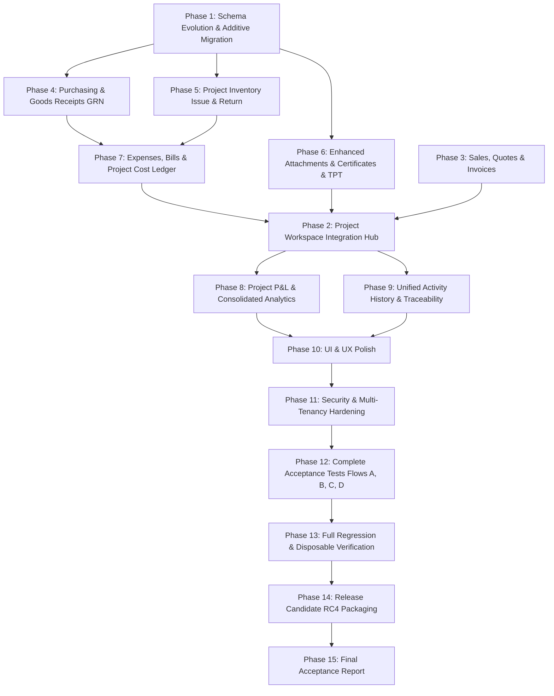

# SPARK ADMIN ERP — PROJECT-CENTRIC ERP INTEGRATION PLAN
**Document Version:** 1.0.0  
**Status:** Approved for Execution  
**Target Candidate:** Release Candidate 4 (`rc4`)  
**Database Guard:** Strictly `spark_project_costing_disposable_test` (All protected DBs barred)

---

## 1. Architecture Overview & Design Invariants

Spark Admin ERP is structured around an integrated Express/EJS/Prisma architecture with strict double-entry accounting. This implementation plan connects procurement, inventory, project cost accounting, and customer billing into a unified, traceable business engine.

### 1.1 Core Business Invariants
1. **Zero Double Counting:** An item purchased for inventory is never recognized as a project actual cost until it is issued to the project.
2. **Commitment vs Cost Independence:** A Purchase Order records procurement commitment. It never produces financial journal entries or project actual expenses.
3. **Receipt vs Billing Independence:** A Goods Receipt (GRN) records warehouse physical stock entry and delivery verification without prematurely creating supplier accounts payable.
4. **Standalone Modularity:** Any invoice, purchase order, supplier bill, stock movement, or expense can be created without a project link and will function completely independently.
5. **Strict Multi-Tenancy:** Every query, insertion, update, and attachment download enforces business/tenant scoping. Cross-tenant references yield HTTP 404 or 400.
6. **Double-Entry Ledger Integrity:** All posted journals must balance ($\sum \text{Debit} = \sum \text{Credit}$, delta = 0) and maintain immutable audit histories.

---

## 2. Phased Execution Roadmap

---

## 3. Detailed Phase Breakdown

### Phase 1 — Authoritative Business Data Model & Migration
1. **Schema Enhancements in `prisma/schema.prisma`:**
   - Define `GoodsReceipt` model (`receiptNumber`, `businessId`, `purchaseOrderId?`, `supplierId`, `supplierName`, `deliveryChallanNumber`, `receiptDate`, `storeLocation`, `status`, `notes`, `projectId?`, `receivedById`).
   - Define `GoodsReceiptItem` model (`goodsReceiptId`, `purchaseOrderItemId?`, `itemId?`, `name`, `unit`, `orderedQuantity`, `receivedQuantity`, `acceptedQuantity`, `rejectedQuantity`, `unitCost`, `totalCost`, `stockMovementId?`).
   - Add `projectId Int?` to `PurchaseOrderItem` with relation to `Project`.
   - Add `storeLocation String?` to `StockMovement`.
   - Add enhanced metadata to `ProjectAttachment` (`title`, `category`, `description`, `referenceNumber`, `issueDate`, `expiryDate`).
   - Update reverse relations on `Business`, `Project`, `PurchaseOrder`, `Item`, `User`.
2. **Additive Migration Generation:**
   - Create migration `prisma/migrations/20261018200000_add_goods_receipts_and_enhanced_attachments/migration.sql`.
   - Apply safely via `node scripts/prisma-test.js migrate deploy`.
   - Generate updated Prisma Client via `node scripts/prisma-test.js generate`.

### Phase 4 & 5 — Purchasing, Goods Receipt (GRN) & Project Inventory
1. **Backend Purchasing Enhancements:**
   - Update `app/services/purchaseOrder.service.js` to accept and persist `projectId`, validate tenant ownership, and support optional line-level `projectId`.
   - Update `app/views/purchases/po-editor.ejs` to include project selector and expected store location.
2. **Goods Receipt Service & Controller (`goodsReceipt.service.js`):**
   - Create receipt against PO lines (supports full receipt, partial receipt, multiple receipts).
   - Validate quantities: received cannot be negative; accepted + rejected = received; block over-receipt beyond ordered quantity.
   - Automatically generate `StockMovement(movementType: 'RECEIPT', storeLocation)` for accepted items into inventory.
   - Update PO status: `PARTIALLY_RECEIVED` or `RECEIVED` when all lines fulfilled.
   - Web routes: `GET /purchases/orders/:id/receive` (GRN form pre-filled from PO), `POST /purchases/orders/:id/receive`, `GET /purchases/receipts`, `GET /purchases/receipts/:id`.
3. **Project Material Allocation, Issue and Return:**
   - In `app/services/stockMovement.service.js`, add `issueMaterialToProject` and `returnMaterialFromProject`.
   - On issue: decrease store stock, prevent negative stock, calculate weighted average cost, record `ProjectCost` (`category: 'MATERIALS', sourceType: 'STOCK_MOVEMENT'`).
   - On return: increase store stock, record return movement, idempotently adjust or void project cost.

### Phase 6 — Enhanced Project Documents, Certificates & TPT
1. **Attachment Service & Model (`attachment.service.js`):**
   - Support `title`, `category` (enum/string: `CERTIFICATE`, `TPT`, `DELIVERY_CHALLAN`, `INSPECTION`, `WARRANTY`, `COMPLIANCE`, `OTHER`), `description` (rich text), `referenceNumber`, `issueDate`, `expiryDate`.
   - Implement XSS sanitization on rich-text descriptions.
   - Add metadata update endpoint (`updateAttachmentMetadata`).
2. **Project Workspace Documents Tab:**
   - Category filtering badges (All, Certificates, TPT, Challans, Inspection, Compliance).
   - Rich-text description display and safe preview/download modal.
   - Edit metadata modal without re-uploading file.

### Phase 7 — Expenses, Supplier Bills & Project Cost Ledger
1. **Operating Expenses:**
   - Update `app/services/expense.service.js` and `app/controllers/purchase.controller.js` to accept `projectId`.
   - When project linked: validate tenant project, persist `projectId`, and call `projectCostLedgerService.recordCost` (`category: 'EXPENSE', sourceType: 'EXPENSE'`).
   - Standalone expenses continue normal general ledger posting without project cost entry.
2. **Supplier Bill Matching:**
   - Allow referencing PO and GRN on supplier bill.
   - Maintain tracked inventory vs direct expense distinction to guarantee zero double counting.

### Phase 2, 3 & 9 — Project Workspace Hub & Unified Activity Timeline
1. **Workspace Data Retrieval in `project.controller.js`:**
   - Query and pass: `purchaseOrders`, `goodsReceipts`, `quotations`, `invoices`, `supplierBills`, `stockMovements` (divided into Store Stock, Reserved, Issued, Returned), `expenses`, `attachments`, `subledgerCosts`.
   - Build unified activity timeline: aggregate and chronologically sort events from all related entities with actor, timestamp, status, and detail link.
2. **Workspace UI Tabs in `projects/details.ejs`:**
   - `#tab-overview`: KPIs, progress, budget vs actual, quick actions.
   - `#tab-sales`: Quotations table + Invoices table with status and drilldowns.
   - `#tab-purchases`: Purchase Orders table + Supplier Bills table with status.
   - `#tab-receipts`: Goods Receipts (GRN) table with warehouse, accepted/rejected quantities.
   - `#tab-materials`: Store Inventory balances, Issued materials, Returned materials, and Issue Material modal.
   - `#tab-expenses`: Project operating expenses table and Record Expense modal.
   - `#tab-labour`: Timesheets, Daily worker muster roll, and Contractor work orders.
   - `#tab-attachments`: Documents, Certificates, and TPT with category badges and rich-text preview.
   - `#tab-subledger`: Project Cost Ledger with source tracing and GL reconciliation check.
   - `#tab-profitability`: Granular P&L breakdown (Quoted, Invoiced, Cash Collected, Open POs, Goods Received Not Billed, Consumed Costs, Net Margin).
   - `#tab-activity`: Unified chronological transaction timeline.

### Phase 8 — Project Profit & Loss and Consolidated Analytics
1. **Financial Calculations in `project.service.js`:**
   - Revenue: Quoted Value, Invoiced Revenue, Net Recognised Revenue, Cash Collected, Outstanding Receivables.
   - Costs: Open PO commitments, Goods Received Not Billed, Actual Consumed Costs by category (Materials, Labour, Subcontractor, Equipment, Expenses).
   - Profitability: Gross Contribution, Net Project Profit, Margin %, Budget Consumed %.
2. **Portfolio & Consolidated Reporting:**
   - Single Project P&L view.
   - All-Project Portfolio summary table.
   - Consolidated Business P&L reconciling project vs unassigned transactions.

### Phase 10 & 11 — UI/UX Polish & Security Multi-Tenancy Hardening
1. Responsive design across desktop (1280px) and mobile (375px).
2. CSRF tokens, strict validation, tenant boundary protection on all new endpoints.
3. Negative test cases: cross-tenant access rejection, over-receipt blocking, negative stock blocking, duplicate submission prevention.

### Phase 12 — Complete Acceptance Tests (Flows A, B, C, D)
- **Flow A:** Project Sales & Profitability (Customer -> Project -> Quote -> Convert to Invoice -> Payment -> GL & TB reconciliation).
- **Flow B:** Purchase to Inventory to Project (Supplier -> Project PO -> GRN Partial & Full -> Supplier Bill -> Stock Issue to Project -> Stock Return -> Cost Ledger reconciliation).
- **Flow C:** Expense & Project Documents (Project Expense -> Standalone Expense -> Certificate upload -> TPT upload -> XSS & tenant security).
- **Flow D:** Combined Analytics & Business Reconciliation (Single Project P&L -> Portfolio Summary -> Consolidated Business P&L -> Trial Balance zero delta).

### Phase 13, 14 & 15 — Regression, Packaging & Final Acceptance
1. Full serial test suite (`node scripts/test-runner.js`) ensuring 100% pass rate.
2. Disposable 8-gate release verification (`scripts/disposable-release-verification.js`).
3. Package clean candidate `spark-admin-release-candidate-rc4.zip` with manifest and SHA-256 checksum.
4. Compile `docs/PROJECT_INTEGRATION_FINAL_REPORT.md` and update `docs/PRODUCTION_ACCEPTANCE_TRACKER.md`.
